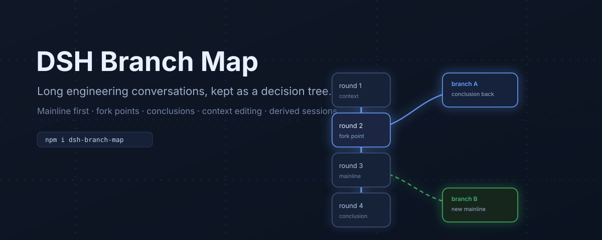

# DSH Branch Map

[](https://www.npmjs.com/package/dsh-branch-map)
[](LICENSE)



A branch map for long engineering conversations in [DeepSeek Harness](https://github.com/deepseek-ai).

Engineering design is not linear. You compare approaches, one branch fails, you bring its conclusion back, and you continue on another path. A normal transcript hides that structure, so the main conversation keeps re-walking old decisions.

This plugin adds a **Conversation View** that keeps the mainline clean while preserving every fork, conclusion, and context edit.

## Why

- **See the decision tree.** Every turn is a node; fork points are explicit; the current mainline is visually dominant.
- **Stop re-explaining.** Save a branch conclusion and return it to the parent conversation as a draft.
- **Compare before committing.** Switch the mainline, inspect sibling branches, and keep the primary surface free of fork clutter.
- **Edit context safely.** Hide rounds from the display, preview the path that would be sent, export it, rewind to a point, or derive a cleaned session.
- **Stay reversible.** All edits work on new branches or new derived sessions. Source sessions are never rewritten.

## Features

### Mainline view

- Vertical, reading-oriented turn chain. Each card separates **AI conclusion** (top) from **your compressed intent** (bottom).
- Conclusion and decision turns are highlighted; a conclusion rail collects saved conclusions.
- Fork points collapse into `⑂N` pills by default. Expanding one branch keeps the path to the root visible.
- Fixed center anchor and pinned inspector keep both sides steady while the wheel steps through turns.
- `Follow` / `Pin` controls; mainline follows the selected branch when you choose it.

### Tree view

- Tidy vertical tree of turns and folded gaps. Toggle `Mainline / Tree` in the toolbar.
- Three LOD levels: title + intent (≥80%), title only (≥50%), dots (<50%).
- Current path, current session, selection, and side branches use different visual states.
- The two views keep independent cameras; branch expansion, conclusions, and mainline state are shared.

### Context editing

- **Hide / restore a round** for display only. Hidden rounds disappear from the mainline, tree, inspector, and path preview; the real session log and model context are untouched.
- **Context path preview** shows the rounds that would go into the next request, marked as a prediction, with hidden counts. Export it as Markdown.
- **Rewind here** creates a new branch that keeps only the context up to the selected turn. Later turns stay in the original branch.
- **Merge conclusions** collects saved conclusions from child branches into one editable message and fills the composer.
- **Derive session (Phase 5)** rebuilds a clean derived session with selected rounds removed, using the Host `agents.create({ seed })` path. The source session is preserved; the derived session records `parentSession` and appears as a child branch.

## Install

### From the DSH plugin market index

In DSH, open **Plugins**, enable **Experimental plugins → Custom plugin indexes**, then add this index URL:

```
https://raw.githubusercontent.com/Matthew-Laplace/dsh-branch-map/main/market/index.json
```

The **Discover** tab will list `dsh-branch-map`; install it from there.

### From npm / plugin manager

The package is a standard DSH bundle. Install with the plugin manager using target `dsh-branch-map@0.2.0`, or:

```bash
npm view dsh-branch-map
```

### Requirements

- DSH `>=0.2.2-rc.1 <0.3.0`
- Web UI profile (the plugin registers a `conversation.view` and a composer dock).

## Usage

1. Open the **分支图 / Branch Map** view in the conversation view switcher.
2. Start with the mainline. Fork a turn with the `＋` button or the inspector's **Fork from here** action.
3. In a branch, save a conclusion; return it to the parent with **Save and return**.
4. Use `⑂N` to expand only the branch you need. Toggle `Show all branches` when you want the full picture.
5. Switch `Mainline / Tree` to compare structure versus reading flow.
6. For context editing, open a turn's inspector, hide rounds, preview the context path, then rewind or derive a new session.

### Engineering loop

```
mainline ──┬── approach A ── conclusion A
           │        └─ return conclusion
           ├── approach B ── conclusion B
           │        └─ choose as mainline
           └── cleaned derivation ── continue
```

## Data and privacy

- Conversation graph data is read through the Host `sessionQuery` service.
- Branch metadata (labels, fork points, conclusions, derived-session lineage) is stored as a sidecar file under `$DSH_HOME/plugins/branch-map/meta.json`.
- Display-only preferences (mainline, hidden rounds, mode, walk state) live in the browser's `localStorage`.
- Derived sessions are real DSH sessions created through `agents.create`; the source session is not modified.
- No network calls are made by the plugin itself.

## Limitations

- Hidden rounds remove content from the **display**, not from the real session log or model context. Use **Derive session** when you need a real cleaned context.
- A derived session can be large: the seed may reach several MB on long conversations. Cross-turn compaction summaries can still mention removed rounds.
- Hiding a round that anchors a fork can move that branch's anchor to the nearest visible turn.
- The plugin is built for the Web UI. It does not change DSH's append-only log format.

## Development

```bash
# syntax checks
node --check index.js
node --check client.js

# the local smoke harness (SSR + jsdom) is maintained outside this package
```

The plugin is a single client file (`client.js`) plus a Host route (`index.js`), with `cordis.patch.yml`, `locale/`, and an SVG icon. It intentionally avoids a bundler so DSH's client module loader can hot-swap it.

### Verification performed

- Client smoke test: 14/14 (loading, empty graph, full graph, branch collapse/expand, long-conversation folding, turn walk, style cleanup).
- Host Phase 5 isolated end-to-end: a temporary DSH web instance loaded the bundle; a real 2-turn session was copied in; dry-run produced an 8-event seed; real `agents.create` created a new session with `parentSession` + `isSeeded`; the new log contained one clean turn; the parent graph displayed the derived child.

## 中文说明

面向**工程场景**的长对话：反复沟通方案、比较分支、回收结论。DSH 分支图把每轮对话做成节点，把分叉收成 `⑂N`，让你在主线上少走弯路。

- **主链视图**：竖向阅读；卡片上方是 AI 结论，下方是你的意图压缩；结论和决策高亮；分叉默认收束。
- **树视图**：按分叉层级浏览，三档缩放密度；和主链共享主线、结论、展开状态。
- **上下文编辑**：隐藏轮次（只影响显示）、路径预览与 Markdown 导出、回退到某一轮、汇总各分支结论、删除隐藏轮生成新派生会话。源会话永远保留。
- **工程闭环**：分叉比较 → 保存结论 → 回到主线 → 选择新主线；需要干净上下文时用派生会话继续。

安装：DSH → 插件 → 实验性插件 → 打开「自定义插件索引」，添加上面的 index URL，在 Discover 中安装。

## License

MIT © 2026 syc-ai
